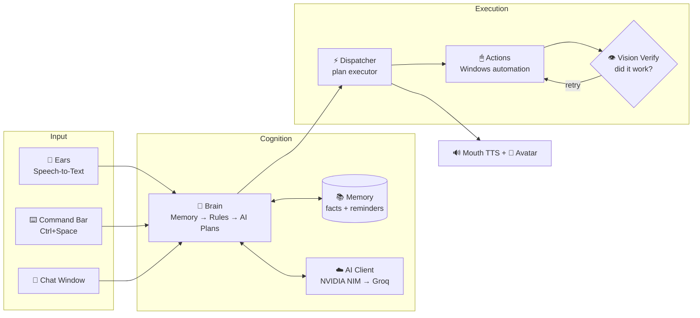

<div align="center">

# 🎙️ Seetha AI

### An open-source, agentic desktop AI assistant for Windows

*Voice in. Actions out. She listens, thinks, plans, acts on your computer — and verifies her own work.*

[](https://www.python.org/)
[](#-quick-start)
[](LICENSE)
[](tests/test_suite.py)
[](#-contributing)
[](#-api-keys)

**[Quick Start](#-quick-start)** · **[Features](#-features)** · **[Architecture](#-architecture)** · **[Roadmap](#-roadmap)** · **[Contributing](#-contributing)** · **[Author](#-about-the-author)**

<br>

**No account. No server. No telemetry. No cost.**
Your own free API key, your own machine — your data never leaves either.

</div>

---

## 💡 Why Seetha?

Most "AI assistants" are chatboxes. Seetha is an **agent with hands**:

- 🗣️ **Say it any way you want** — *"make it louder"*, *"dim the screen"*, *"open the chrome browser please"* — a local rules engine executes instantly, zero API calls, zero latency.
- 🤖 **Multi-step autonomy** — *"open Notepad and write a poem about rain"* → the LLM composes a plan, the dispatcher executes it step by step, and a **vision model checks the screen after each step** to verify it actually worked — retrying on failure. The observe → act → verify loop, on your desktop.
- 🧠 **She remembers you** — facts persist across restarts and are injected into every conversation, ChatGPT-memory style. Reminders fire with chime + Windows notification + voice.
- 🫥 **Lives in the background** — closes to the system tray; **Ctrl + Space** summons a Spotlight-style command bar from inside any app.
- 🪫 **Degrades gracefully** — no API key? App control, media, volume, brightness, and reminders still work fully offline.

## ✨ Features

| | Capability | Say something like |
|---|---|---|
| 🗨️ | **Conversational AI** | "Good morning", anything — LLM-powered chat with personality |
| 🚀 | **App control** | "Open Chrome", "Close everything", "Open notepad and calculator" |
| 🤖 | **Agentic multi-step tasks** | "Open Notepad and write a poem" — planned, executed, screen-verified |
| 🔊 | **Direct system control** | "Increase the volume", "Set brightness to 40", "Take a screenshot" |
| 🧠 | **Persistent memory** | "Remember my exam is on Friday" / "What do you remember?" |
| ⏰ | **Reminders** | "Remind me at 6 pm to call amma" — sound + notification + voice |
| 💬 | **WhatsApp automation** | "Send a WhatsApp message to Ramu saying I'm on my way" |
| ▶️ | **YouTube smart-play** | "Play that new Seetha Ramam song" |
| 🔬 | **Deep Research engine** | "Research ISRO's next mission" — multi-source, fact-verified, confidence-scored reports |
| 📅 | **Instant meetings** | "Create a meeting" — Google Meet link detected, saved to Notepad + clipboard |
| 👩 | **Animated avatar** | Blinks, lip-syncs while speaking — flicker-free rendering |
| ⌨️ | **Command bar** | **Ctrl + Space** anywhere in Windows |

## ⚡ Quick Start

> Requires **Windows 10/11** and **[Python 3.10+](https://python.org)** (tick *"Add to PATH"* during install).

```bash
git clone https://github.com/adharshramu12/Seetha_ai.git
cd Seetha_ai
```

**Double-click `StartSeetha.bat`** — it creates a virtual environment, installs everything, and launches Seetha. On first run she opens Settings and asks for one key:

1. Visit **[build.nvidia.com](https://build.nvidia.com)** → sign in (free) → any chat model → **Get API Key** → copy the `nvapi-...` key.
2. Paste it into Settings → **Save & Test AI**.
3. Click **Activate Seetha** and start talking. 🎉

<details>
<summary><b>Manual install</b></summary>

```bash
python -m venv .venv
.venv\Scripts\activate
pip install -r requirements.txt
python -m seetha.main
```
</details>

Keys are stored **only** at `%LOCALAPPDATA%\Seetha\settings.json` and are sent only to the provider you got them from. There is no Seetha server.

## 🏗 Architecture



**Command pipeline — cheapest first, AI last:**

`Memory intents` → `WhatsApp / YouTube / Research addons` → `Rules engine (instant, offline)` → `LLM plan → execute → verify → retry`

| Layer | File | Responsibility |
|---|---|---|
| UI Shell | [`seetha/main.py`](seetha/main.py) | Tkinter app, splash, avatar, chat, research board, tray wiring |
| Command Bar | [`seetha/command_bar.py`](seetha/command_bar.py) | Global Spotlight-style overlay |
| Tray | [`seetha/tray.py`](seetha/tray.py) | Background lifetime, notifications |
| Settings | [`seetha/settings_ui.py`](seetha/settings_ui.py) · [`settings_store.py`](seetha/settings_store.py) | Self-rendering key manager, local JSON store |
| Orchestration | [`seetha/core.py`](seetha/core.py) | Listen→Process→Dispatch→Speak loop, reminder scheduler, thread-safe UI queue |
| Cognition | [`seetha/brain.py`](seetha/brain.py) | Intent routing, agentic plan generation |
| Memory | [`seetha/memory.py`](seetha/memory.py) | Persistent facts + NL reminder parsing |
| AI Client | [`seetha/ai_client.py`](seetha/ai_client.py) | Unified `chat_completion()` + `vision_completion()` with provider fallback |
| Execution | [`seetha/dispatcher.py`](seetha/dispatcher.py) | 31 action handlers + verify-retry plan executor |
| Automation | [`seetha/actions.py`](seetha/actions.py) | PyAutoGUI / pywinauto / psutil with safety guards |
| Speech | [`seetha/ears.py`](seetha/ears.py) · [`seetha/mouth.py`](seetha/mouth.py) | Mic auto-selection + thread-safe TTS worker |
| Research | [`seetha/premium_research.py`](seetha/premium_research.py) | 10-step multi-source research: classify → collect → verify → synthesize → score |

### Engineering decisions worth reading

- **Rules before AI** — deterministic phrasing matchers handle the 80% of commands that don't need a model. Faster, free, and works offline.
- **Verify, don't hope** — GUI automation fails silently; Seetha screenshots after critical steps and asks a vision model *"did that work?"* before claiming success.
- **Thread-safe TTS worker** — Windows SAPI breaks silently across threads; one dedicated speech thread owns the engine, every caller queues to it.
- **Self-rendering Settings** — every API key is declared once in `KEY_SPECS`; the UI, placeholders, help-links, and storage all derive from it. Adding an integration is a 10-line diff.
- **Safety guards** — process kills match executable names only (never command lines), protected-process safelist, voice confirmation for destructive actions.

## 🔑 API Keys

Only one key is needed to unlock everything conversational — the rest are optional enrichments:

| Key | Unlocks | Free at | Required |
|---|---|---|---|
| **NVIDIA NIM** | The brain — chat, planning, vision verify | [build.nvidia.com](https://build.nvidia.com) | ✅ recommended |
| Groq | Fallback brain if NVIDIA is down | [console.groq.com](https://console.groq.com/keys) | optional |
| Google Gemini | Richer Deep Research synthesis | [aistudio.google.com](https://aistudio.google.com/apikey) | optional |
| SerpAPI | Google-quality research search | [serpapi.com](https://serpapi.com) | optional |
| NASA · OpenSky · Trefle | Space / flight / botany research data | [api.nasa.gov](https://api.nasa.gov) · [opensky-network.org](https://opensky-network.org) · [trefle.io](https://trefle.io) | optional |

## 🧪 Testing

```bash
python -m tests.test_suite
```

28 offline tests (~10 s, no keys, no network, no GUI): module imports, natural-language rule matching, memory/reminder parsing and firing, keyless degradation, and a guarantee that **every action the LLM is allowed to emit has a registered handler**.

## 🗺 Roadmap

- [ ] 🎙 Wake word — *"Hey Seetha"* (openWakeWord) · [#3](https://github.com/adharshramu12/Seetha_ai/issues/3)
- [ ] 👁 Screen Q&A — *"What's on my screen?"* via NIM vision · [#4](https://github.com/adharshramu12/Seetha_ai/issues/4)
- [ ] 🏠 Fully-local mode — Ollama provider, zero cloud · [#1](https://github.com/adharshramu12/Seetha_ai/issues/1) `good first issue`
- [ ] 🗣 Neural TTS — Edge-TTS voices, interruptible speech · [#5](https://github.com/adharshramu12/Seetha_ai/issues/5)
- [ ] 🧩 Skills plugin system — drop a Python file in `skills/`, community-extensible · [#7](https://github.com/adharshramu12/Seetha_ai/issues/7)
- [ ] 🌏 Telugu voice mode — full `te-IN` STT/TTS · [#6](https://github.com/adharshramu12/Seetha_ai/issues/6)
- [ ] 🐧 Linux/macOS actions backend

Want one of these to exist sooner? Comment on its issue, [open a new one](https://github.com/adharshramu12/Seetha_ai/issues/new), or grab one labelled [`good first issue`](https://github.com/adharshramu12/Seetha_ai/labels/good%20first%20issue) ⬇

## 🤝 Contributing

Contributions are very welcome — this project is built to be extended:

1. Fork → branch → change → `python -m tests.test_suite` → PR.
2. Keep the layering: UI never touches automation directly; everything flows through **Service → Brain → Dispatcher**.
3. Good first issues: an Ollama provider in [`ai_client.py`](seetha/ai_client.py) ([#1](https://github.com/adharshramu12/Seetha_ai/issues/1)), WhatsApp contacts from a user-editable `contacts.json` ([#2](https://github.com/adharshramu12/Seetha_ai/issues/2)), or new phrasings in [`rules.py`](seetha/rules.py) (free speed for everyone).

## 🧰 Troubleshooting

| Problem | Fix |
|---|---|
| `PyAudio` install fails | `pip install pipwin && pipwin install pyaudio` |
| Mic not detected | Windows Settings → Privacy → Microphone access |
| "No AI key configured" | Settings → paste NVIDIA key → **Save & Test AI** |
| Actions don't reach a window | Run from a normal (non-admin) terminal |
| Logs | `%LOCALAPPDATA%\Seetha\logs\seetha.log` |

## 👨‍💻 About the Author

<table>
<tr>
<td>

**Adharsh Kumar Bachu** — AI Engineer

I designed and built Seetha end-to-end: the agentic planning loop, vision-verified execution, persistent memory system, multi-provider AI client, Windows automation layer, and the release-gated test suite.

I'm passionate about building **production-grade agentic AI systems** — assistants that don't just talk, but act, verify, and recover.

📫 **Open to AI engineering opportunities and collaborations.**

[](https://github.com/adharshramu12)
[](https://www.linkedin.com/in/adharsh-kumar-bachu/)
[](mailto:adharshklu1234@gmail.com)

</td>
</tr>
</table>

## 📄 License

[MIT](LICENSE) © 2026 Adharsh Kumar Bachu — use it, fork it, ship it. Just keep the notice.

---

<div align="center">

**If Seetha impressed you, a ⭐ helps more people find her — and tells me to keep building.**

*Built with ❤️ in India.*

</div>
